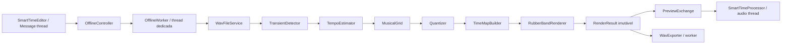

# CHi SMART TIME — arquitetura 0.1.0 proposta

Este documento especifica classes e invariantes; não descreve funções já implementadas.
O primeiro protótipo de código agrupa algumas dessas responsabilidades em
`src/core/Engine.*`, `src/core/Wav.cpp` e `src/plugin/Plugin.cpp`. A separação
completa de classes continua como direção de arquitetura, não como estado atual.

## Fronteiras e fluxo



Separar `SmartTimeCore` (DSP C++17 sem GUI), `SmartTimeAudioIO` (JUCE e WAV),
`SmartTimeStretch` (adaptador Rubber Band), `SmartTimePlugin` (JUCE VST3), e
`SmartTimeTests` (CLI/CTest). A interface acessa somente o controlador e snapshots.
Não iniciar correção da entrada em tempo real na versão 0.1.

Estrutura de código prevista:

```text
CMakeLists.txt
cmake/Dependencies.cmake
src/core/{AudioClip,TransientDetector,TempoEstimator,MusicalGrid,Quantizer,TimeMapBuilder}.*
src/stretch/{ITimeStretcher,RubberBandRenderer}.*
src/offline/{OfflineController,OfflineWorker,OfflineSession,WavFileService,WavExporter}.*
src/plugin/{SmartTimeProcessor,PreviewExchange,PluginState}.*
src/ui/{SmartTimeEditor,VintageLookAndFeel,WaveformGridView,VuMeter}.*
tests/{core,offline,lifecycle}/
```

## Contratos das classes

| Classe / estrutura | Responsabilidade e contrato |
| --- | --- |
| `AudioClip` | PCM planar float mono/estéreo, sample rate original e tamanho em frames de 64 bits. Dados finitos, canais de mesmo tamanho. Imutável após publicação. |
| `ImportLimits` | Limites de bytes, frames e duração; validar antes de alocar. Estimar memória incluindo entrada, saída, preview e scratch, com orçamento explícito. |
| `WavFileService` | Importar apenas WAV suportado, validar cabeçalho e tamanho, rejeitar zero frames, canais > 2, sample rate inválido e dados não finitos. Trabalho de arquivo só no worker. |
| `TransientDetector` | Produzir ataques com frame, força e confiança usando energia e spectral flux. Nenhuma promessa de detectar notas polifônicas individualmente. |
| `TempoEstimator` | Produzir candidatos BPM, confiança calibrada e ambiguidade metade/dobro. Silêncio ou evidência insuficiente resultam em “indeterminado”. |
| `MusicalGrid` | Grade com BPM, origem, compasso, subdivisão e swing. Não inferir fase musical correta apenas do BPM. |
| `Quantizer` | Associar ataques a alvos válidos e aplicar intensidade/naturalidade. Não alterar os dados de entrada. |
| `TimeMapBuilder` | Converter propostas em âncoras estritamente crescentes de entrada/saída, com limites de stretch e relatório de conflitos. |
| `ITimeStretcher` | Interface injetável: clip + mapa + opções + token de cancelamento → resultado ou erro tipado. |
| `RubberBandRenderer` | Modo offline, análise e processamento em blocos, pitch scale 1 quando solicitado, canais ligados e key frames comuns aos canais. Confirmar suporte na versão fixada. |
| `RenderResult` | PCM corrigido e metadados imutáveis: sample rate, parâmetros, mapa, ataques, BPM/confiança, duração e diagnóstico. |
| `OfflineSession` | Original, versão de parâmetros, análise e render atual; invalida resultados quando a configuração relevante muda. |
| `OfflineController` | Submete jobs, atribui generation ID, cancela resultado obsoleto e transmite progresso. Não pertence ao editor. |
| `OfflineWorker` | Thread persistente única; captura exceções no limite do job, publica erro/progresso, nunca toca componentes GUI. |
| `PreviewExchange` | Troca de buffers preparados usando slots de capacidade fixa, confirmação pela audio thread e descarte fora dela. |
| `SmartTimeProcessor` | Pass-through do host em idle; reprodução explícita do WAV em preview. Estado persistente versionado e parâmetros JUCE. |
| `SmartTimeEditor` | Controles reais, desenho de waveform/grade e progresso; destruível sem invalidar o worker. |
| `WavExporter` | Exportar resultado válido para arquivo temporário vizinho e substituir destino após sucesso. Erro/cancelamento remove temporário, preservando destino anterior. |

## Detecção e estimativa

1. Importar preservando sample rate, alinhamento e relação entre canais.
2. Calcular energia e flux positivo de magnitudes STFT, inicialmente FFT 2048 e hop
   256 a 48 kHz; escalar parâmetros com sample rate e validar com fixtures.
3. Agregar evidência dos canais por energia/flux, evitando cancelamento de fase de
   um simples downmix L+R. Normalização local robusta e limiar adaptativo.
4. Peak picking com intervalo refratário e refinamento de posição no domínio do
   tempo; compensar o centro da janela. Guardar eventos fracos separadamente.
5. Estimar BPM por autocorrelação da curva de onset e histogramas de intervalos,
   avaliando candidatos metade/dobro, regularidade e cobertura. Expor ambiguidade.
6. Estimar fase inicial como sugestão. Permitir ajuste de origem da grade em ms e
   escolha do primeiro tempo; BPM sozinho não determina o início dos compassos.

## Grade, correção e mapa temporal

Usar posições internas de 64 bits em frames e calcular segundos/batidas em double.
Para subdivisão de denominador `d`, o passo é `sampleRate * 60/BPM * 4/d`.
Compasso define agrupamento e acentos; não altera arbitrariamente o passo.
Swing `s` em [-0,5; +0,5] desloca o segundo ponto de cada par por `s * passo`.

Associar cada ataque ao alvo mais próximo respeitando ordem e colisões.
A intensidade `a` em [0; 1] propõe `destino = origem + a * (grade - origem)`.
Naturalidade define uma zona morta ajustável e suaviza deslocamentos de eventos
fracos; será determinística, sem jitter aleatório. Documentar a função exata e
seu efeito na interface quando implementada.

Fixar início e fim do clip para manter duração e posição na sessão. Reconciliar
colisões e arredondamentos sem deslocar o mapa para trás. Exigir incremento de
pelo menos um frame em ambos os eixos. Rejeitar/suavizar razões locais extremas
fora de um intervalo configurado e informar eventos limitados; nunca aceitar
segmentos de duração zero. Guardar zonas de proteção em volta dos ataques;
reconciliar sobreposições antes de criar key frames. Não processar cada canal
com mapas ou detectores independentes.

Rubber Band deverá estudar o áudio completo e processar usando um único mapa
de frames de entrada para saída. Validar o arredondamento, a duração retornada,
as caudas e a posição real de transientes. Pitch scale 1 é uma configuração,
não prova de preservação de afinação: medir na saída. Com “Preservar afinação”
desligado, usar resampling variável ao longo do mapa e identificar a alteração
de pitch como intencional. O adaptador deve permitir testar os dois caminhos.

## Threads, cancelamento e destruição

- `processBlock` não abre arquivos, aloca/libera memória, espera mutex, chama
  Rubber Band, analisa FFT ou destrói objetos que possam liberar grandes buffers.
- A mensagem de preview usa uma fila SPSC de capacidade fixa. O worker publica um
  slot pronto; o callback lê e confirma a troca; somente o worker recicla o slot
  anterior após confirmação. Não usar troca de `shared_ptr` no callback: o último
  decremento poderia destruir o buffer ali. Não presumir atomics de 64 bits
  lock-free sem verificar no alvo; usar atomics triviais adequados para índices.
- Com a fila cheia, reter/coalescer o novo resultado no produtor; não bloquear
  o áudio e não liberar dados ainda em uso. Slots não confirmados permanecem vivos.
- No desligamento da reprodução/host, suspender o consumidor antes de recuperar
  slots. Definir explicitamente estado sem callback para não esperar confirmação
  indefinidamente. O destrutor aguarda apenas depois que o host parou de chamar
  o processador, conforme o contrato JUCE, e antes de liberar armazenamento.
- Token de cancelamento compartilhado com lifetime independente do editor,
  consultado entre blocos de importação, análise, estudo, render e exportação.
  Nunca destacar threads. O destrutor cancela, impede novos jobs e faz join antes
  de destruir dependências. Medir a duração máxima de cada chamada de biblioteca.
- Jobs recebem cópias de parâmetros e IDs; resultados de gerações antigas são
  descartados no worker. Notificação de GUI via polling de snapshots no message
  thread; não enfileirar callbacks com `this` cru do editor.
- `bad_alloc`, erro de decoder, falha de I/O e exceções de biblioteca viram erros
  tipados no worker. Nunca propagar exceções através do callback de áudio.

## Reprodução, estado e host

Pré-converter buffers original/corrigido para o sample rate atual fora do callback.
Mudança de sample rate cancela preview e exige novo buffer compatível. Mudança
de tamanho de bloco não pode exigir resize em `processBlock`. Reprodução copia
por blocos até EOF, zera a cauda e para; A/B preserva posição e usa crossfade
curto prealocado para evitar clicks. Preview substitui a saída enquanto ativo;
idle mantém a entrada do host. Mostrar esse comportamento na UI.

O transporte interno e o transporte do host são distintos. Leitura de BPM do
playhead no callback só atualiza um snapshot pequeno; nunca inicia análise ali.
Se o host não fornece BPM válido, desabilitar “BPM da DAW” e explicar o motivo.
Modo tempo real futuro fica desabilitado e rotulado. Latência de correção do
host em 0.1 é zero porque a entrada não é corrigida; não declarar compensação
fictícia para justificar o preview offline.

`PluginState` versiona parâmetros, caminhos externos, identidade do arquivo,
origem da grade e preferências. Não serializar PCM no estado do host. Capturar
um snapshot pequeno sem aguardar render. Reabrir arquivo externo só por job;
arquivo ausente mostra estado recuperável. Não declarar a sessão portátil sem
copiar o áudio junto ao projeto por ação explícita do usuário.

## Interface e controles

Editor redimensionável com proporção base próxima da referência, mínimo usável
e layout escalonado. JUCE real com `LookAndFeel`, textura gerada/desenhada,
madeira escura, metal, dourado envelhecido, luz âmbar e logotipo CHi. Recursos
gráficos externos exigem origem/licença registrada. VUs recebem peaks medidos
nos fluxos reais, com decaimento no timer de GUI.

| Controle | Ligação funcional prevista |
| --- | --- |
| Abrir áudio | FileChooser assíncrono → job de importação WAV |
| Detectar BPM | Análise do WAV; exibir candidatos e confiança |
| BPM da DAW / fixo / detectado | Fonte exclusiva da grade, com estados indisponíveis explícitos |
| Compasso e origem | Numerador/denominador e offset da grade |
| 1/4, 1/8, 1/16, 1/32 | Passo da grade e recomputação da correção |
| Intensidade / naturalidade / swing | Parâmetros do quantizador; render obsoleto é invalidado |
| Preservar afinação | Escolhe stretch pitch-preserving ou resampling variável |
| Proteger transientes | Zonas protegidas e opção correspondente do adaptador |
| A/B | Buffer original/corrigido, B indisponível até render válido |
| Play / Stop | Preview interno e posição comum de comparação |
| Exportar WAV | Job de exportação do render atual, indisponível para resultado obsoleto |
| Cancelar | Token do job atual, progresso e retorno ao estado consistente |
| Tempo real | Desabilitado: “Futuro — correção da entrada em tempo real” |

Não incluir controles decorativos de auto gain ou suavização se não houver DSP
correspondente. Não mostrar “notas corrigidas”: mostrar ataques detectados,
ataques ajustados e conflitos limitados. A waveform exibe âncoras e grade sobre
dados reais. Estados: vazio, importando, pronto para análise, analisando,
analisado, renderizando, corrigido, exportando, cancelando e erro recuperável.

## Próxima sequência de implementação

1. Criar CMake e targets core/tests, fixar dependências e validar toolchain.
2. Implementar WAV e detector; fixtures mono, estéreo, silêncio e erro.
3. BPM, grade, quantização e mapa monotônico com testes de propriedades.
4. Integrar Rubber Band e medir timing, pitch, coerência estéreo e duração.
5. Controller, preview, estado e testes de ciclo de vida.
6. Interface JUCE funcional baseada na referência, após contratos DSP testados.
7. Release x64 com MSVC, validador VST3 e matriz Studio One.
